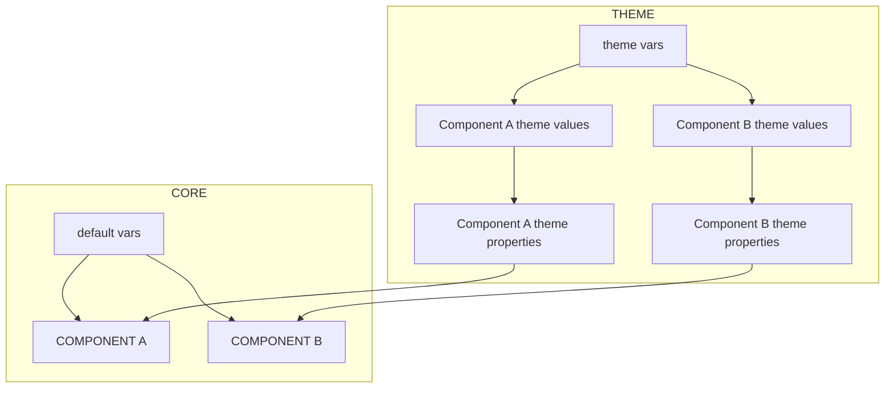

<picture>
  <source media="(prefers-color-scheme: dark)" srcset="images/logo-dark.png" />
  
</picture>

# Higgsboson

Higgsboson is a themeable semantic classless framework to style core native components.

[](https://www.gnu.org/licenses/gpl-3.0)
[](https://codeberg.org/higgsboson/higgsboson/issues)
[](https://codeberg.org/higgsboson/higgsboson)


## Summary

- [Higgsboson](#higgsboson)
  - [Summary](#summary)
  - [What is next](#what-is-next)
  - [Why Higgsboson?](#why-higgsboson)
  - [Project Structure](#project-structure)
    - [Packages](#packages)
      - [Core](#core)
        - [Core folder file structure](#core-folder-file-structure)
        - [Default theme](#default-theme)
          - [assets folder](#assets-folder)
          - [vars.css](#varscss)
        - [Components](#components)
          - [Components docs](#components-docs)
          - [Component files structure](#component-files-structure)
          - [componentA.css](#componentacss)
          - [componentA.html](#componentahtml)
          - [componentA.md](#componentamd)
          - [componentA-model.mjs](#componenta-modelmjs)
          - [componentA-mock.html](#componenta-mockhtml)
      - [Themes](#themes)
        - [Theme folder file structure](#theme-folder-file-structure)
          - [assets](#assets)
          - [components](#components)
          - [fonts.css](#fontscss)
          - [resets.css](#resetscss)
          - [vars.css](#varscss)
          - [index.css](#indexcss)
          - [gitignore](#gitignore)
          - [stylelintignore](#stylelintignore)
          - [stylelintrc](#stylelintrc)
          - [bs-config.json](#bs-configjson)
          - [higgsboson.json](#higgsbosonjson)
          - [index.html](#indexhtml)
          - [LICENSE](#license)
          - [package.json](#packagejson)
          - [postcss.config.js](#postcssconfigjs)
        - [Technical considerations](#technical-considerations)
          - [Complete graph of the ideal higgsboson flow](#complete-graph-of-the-ideal-higgsboson-flow)
        - [Dev a theme](#dev-a-theme)
        - [Use a theme](#use-a-theme)
  - [How to use](#how-to-use)
    - [Install](#install)
    - [Build](#build)
      - [Plugins that we are using in the build process](#plugins-that-we-are-using-in-the-build-process)
    - [Release](#release)
    - [Development](#development)
    - [Testing](#testing)
    - [Lint](#lint)
    - [Format](#format)
    - [Pre-push](#pre-push)
      - [Usage](#usage)
  - [How to consume](#how-to-consume)
  - [Tools that could help you to develop in this project](#tools-that-could-help-you-to-develop-in-this-project)
    - [Visual Studio Code IDE](#visual-studio-code-ide)
      - [Visual Studio Code useful Extensions](#visual-studio-code-useful-extensions)

## What is next

Take a look into the active [project board](https://github.com/users/d3v3l0p3z/projects/3/views/2)
or a deeper view in [issues](https://codeberg.org/higgsboson/higgsboson/issues).

## Why Higgsboson?

There are many motivations to see this project as a simple research and development of a system that allows not to reinvent the wheel over and over again.

Now, I know that we have multiple techniques and tools in the ecosystem to solve the same problem, many of them on top of the wave, but my intention is to solve the problem from several points of view:

- The most standard way possible, use the web.
- Minimum coupling between internal parts.
- Oriented to its main responsibility, styling pieces on the screen.
- Fully customizable injectable themes.
- Fast propagation of changes.
- Easily articulated in a design system.
- Independent but easily implementable in any library or front end framework.

## Project Structure

The project is a monorepo that has different packages that can build separately using dependencies from the other ones.

```text
Higgsboson
 ├─ packages
      ├─ core
      │   ├─ src
      │     ├─ components
      │     ├─ theme
      │
      ├─ themes
      │  ├─ captain-america
      │  ├─ caramel
      │
      ├─ utils
          ├─ src
```

### Packages

Higgsboson has different packages that have their own workspace. Those packages are `core`, `themes` and `utils`.

#### Core

Core package contains the core library and the default `theme`. Building the core package you will use Higgsboson with the default theme.

##### Core folder file structure

```text
├─ core
    ├─ src
       ├─ components
       ├─ theme
           ├─ assets
           ├─ vars.css
           ├─ index.css
           ├─ resets.css
```

##### Default theme

###### assets folder

Folder to allocate different kind of assets as images, svgs, fonts, icons etc to the default theme.

###### vars.css

The default theme has variables as fallback to each `core-component-tokens` to each core component.

Higgsboson themes just works with css standard custom variables but we would like to call this entire concept `core-components-tokens`.

```css
--theme-token-a-default: #FFFFFF;
--theme-token-b-default: 12px;
  .
  .
  .
--theme-token-n-default: 1px solid var(--theme-token-a);
```

**default core components tokens convention name**

> [!WARNING]
> Take care here, in the same way that I will explain that for each `theme tokens` you can use the naming convention that you want, in this case, you must follow the existing naming convention.

```
--hggs-border-primary-default
  ──── ────── ─────── ───────
    ▲     ▲       ▲      ▲
    │     │       │      │
    │     │       │      │
    │     │       │      │
    │     │       │      │
  prefix property │     suffix
                  │
                  │
              modifier
```

###### index.css

Use this file as theme entry point. [Import](https://github.com/postcss/postcss-import#readme) here all the default theme files that core need to compose higgsboson as default.

##### Components

All available core components defined from their selectors, properties and values in the form of variables connected to the theme variables or own variables for this component.

###### Components docs

- [Avatar](/packages/core/src/components/avatar/avatar.md)
- [Avatars](/packages/core/src/components/avatars/avatars.md)
- [Blockquote](/packages/core/src/components/blockquote/blockquote.md)
- [Box](/packages/core/src/components/box/box.md)
- [Button](/packages/core/src/components/buttons/buttons.md)
- [Checkbox](/packages/core/src/components/checkbox/checkbox.md)
- [Dialog](/packages/core/src/components/dialog/dialog.md)
- [Divider](/packages/core/src/components/divider/divider.md)
- [Dropdown](/packages/core/src/components/dropdown/dropdown.md)
- [Field](/packages/core/src/components/field/field.md)
- [Flex](/packages/core/src/components/flex/flex.md)
- [Form](/packages/core/src/components/form/form.md)
- [Grid](/packages/core/src/components/grid/grid.md)
- [Icon](/packages/core/src/components/icons/icons.md)
- [Input](/packages/core/src/components/inputs/inputs.md)
- [Label](/packages/core/src/components/label/label.md)
- [Link](/packages/core/src/components/link/link.md)
- [List](/packages/core/src/components/list/list.md)
- [Logo](/packages/core/src/components/logo/logo.md)
- [Option](/packages/core/src/components/option/option.md)
- [Radio](/packages/core/src/components/radio/radio.md)
- [Select](/packages/core/src/components/select/select.md)
- [Step](/packages/core/src/components/step/step.md)
- [Steps](/packages/core/src/components/steps/steps.md)
- [Switch](/packages/core/src/components/switch/switch.md)
- [Table](/packages/core/src/components/table/table.md)
- [Tag](/packages/core/src/components/tag/tag.md)
- [Text](/packages/core/src/components/text/text.md)
- [Texts](/packages/core/src/components/text/texts.md)
- [Titles (h1, h2, h3, h4, h5, h6)](/packages/core/src/components/titles/titles.md)
- [Tooltip](/packages/core/src/components/tooltip/tooltip.md)

###### Component files structure

```text
components
   ├─ componentA
        ├─ componentA.css
        ├─ componentA.html
        ├─ componentA.md
        ├─ componentA-mock.html
         ├─ componentA-model.mjs
```

###### componentA.css

Selectors, rules, properties and values to this component scoped by selector and **connected with the theme API across component variables and default theme API variables**.

###### componentA.html

Html markup page that loads the component model and renders it with [our custom utils renderer](./packages/utils/src/) into the dev playground.

###### componentA.md

Complete documentation about **component theme API variables**, **component theme API selectors** and markup component use cases.

###### componentA-model.mjs

A javascript module with the declarative data model (`{ title, cases, nodes }`) that [our custom utils renderer](./packages/utils/src/) turns into all the component use cases.

###### componentA-mock.html

The golden file with the expected rendered DOM for the component model. It is **generated** with `npm run mocks:update --workspace packages/utils componentA` — never edit it by hand.

#### Themes

A Higgsboson theme is not more than **a package that contains the theme variables, the theme components variables that should connect with the core components interfaces and the theme entry point**.

There are different workspaces with packages with themes examples to review.

Building each of these themes in their own workspaces you can use Higgsboson with your theme imported on top of Higgsboson core build imported.

> [!NOTE]
> So take into account that to use a theme you should build the core package and the theme package. If you run the script to run the dev environment to a theme, the script run the core package build and the theme package build separately.

Themes are the area where everything related to theming (not default styling) should be managed.

##### Theme folder file structure

```text
theme
 │ ├─ src
 │     ├─ assets
 │     ├─ components
 │     │    ├─ app.css
 |     |    ├─ blockquote.css
 │     │    ├─ box.css
 │     │    ├─ button.css
 │     │    ├─ checkbox.css
 │     │    ├─ dialog.css
 │     │    ├─ divider.css
 │     │    ├─ dropdown.css
 │     │    ├─ field.css
 │     │    ├─ flex.css
 │     │    ├─ form.css
 │     │    ├─ grid.css
 │     │    ├─ icon.css
 │     │    ├─ input.css
 │     │    ├─ label.css
 │     │    ├─ link.css
 │     │    ├─ list.css
 │     │    ├─ logo.css
 │     │    ├─ option.css
 │     │    ├─ radio.css
 │     │    ├─ select.css
 │     │    ├─ step.css
 │     │    ├─ table.css
 │     │    ├─ tag.css
 │     │    ├─ text.css
 │     │    ├─ titles.css
 │     │    ├─ tooltip.css
 │     │
 │     ├─ fonts.css
 │     ├─ index.css
 │     ├─ resets.css
 │     ├─ vars.css
 │
 │
 ├─ .gitignore
 ├─ .stylelintignore
 ├─ .stylelintrc
 ├─ bs-config.json
 ├─ higgsboson.json
 ├─ index.html
 ├─ LICENSE
 ├─ package.json
 ├─ postcss.config.js
```

###### assets

Folder to allocate different kind of assets as images, svgs, fonts, icons etc.

###### components

Theme component interfaces to connect and style different core components from the core package.

All those theme component interfaces **should be composed with the same pattern**:

All should be wrapped by a core `component scope selector`

```css
.component-scope-selector {
  /* ... */
}
```

Inside this `component scope selector` we should define the different values **aka tokens** to the core component tokens available.

To define this different values we could use values it self or a `theme-token`.

```css
.component-scope-selector {
  --core-component-token-available-a: var(--theme-token);   /* A theme token */
  --core-component-token-available-b: 12px;                 /* A value       */
}
```

**You can review the core component tokens available** taking a walk across [core components documentation](#components-docs).

```css
.component-scope-selector {
  --core-component-token-a: var(--theme-variable-a);
  --core-component-token-b: var(--theme-variable-b);
  --core-component-token-c: calc(var(--theme-variable-a)*2);
  /*
        .
        .
        .
  */
  --core-component-token-n: var(--theme-variable-n);
}
```

Or review the [captain-america theme components scope selectors example](./packages/themes/captain-america/src/components/) or the [caramel theme components scope selectors example](./packages/themes/caramel/src/components/).

###### fonts.css

Set here all theme [@font-face](https://developer.mozilla.org/es/docs/Web/CSS/@font-face) or [@import url](https://developer.mozilla.org/es/docs/Web/CSS/@import) that import font files or font css styles to your theme fonts.

###### resets.css

Set here all your css theme resets styles if you needed.

###### vars.css

Put here all your theme variables to populate with them your theme component interfaces.

Higgsboson themes just work with standard css custom variables but we would like to call this entire concept `theme tokens`.

```css
:root {
  --theme-token-a: #FFFFFF;
  --theme-token-b: 12px;
  /*
       .
       .
       .
  */
  --theme-token-n: 1px solid var(--theme-token-a);
}
```

**theme tokens convention name**

The good point in how higgsboson is doing things is that you can use your own theme tokens convention name. This layer is a layer that you can build in your way but, if you want to use the default theme tokens convention name, you should follow this pattern:

```
--hggs-border-primary
  ──── ────── ───────
    ▲     ▲       ▲
    │     │       │
    │     │       │
    │     │       │
    │     │       │
  prefix property │
                  │
                  │
              modifier
```

###### index.css

Use this file as theme entry point. [Import](https://github.com/postcss/postcss-import#readme) here all your theme files that you need to compose your theme on top of higgsboson.

###### .gitignore

Set here all ignore files to the theme workspace package.

###### .stylelintignore

Set here all style rules ignore files to the theme workspace package.

###### .stylelintrc

Set the stylelint rules configuration to the theme workspace package.

###### bs-config.json

Higgsboson use a [lite server](https://github.com/johnpapa/lite-server) to run a dev playground to see how it is going and develop your theme components.

This is the [configuration file](https://github.com/johnpapa/lite-server#custom-configuration) that helps you to run your dev playground.

Usually a `bs-config.json` to a higgsboson theme package should be like:

```json
{
  // browser port
  "port": 8001,
  // files extensions to be serve
  "files": ["./**/*.{html,htm,css,svg,mjs,js,json}"],
  // files paths to be serve
  "server": ["./", "../../utils/src", "../../core"]
}
```

###### higgsboson.json

This file is responsible for manage some of the theme workspace package configuration.

- `outputPath`: Set the output path to the theme build.
- `outputFilename`: Set the output filename to the theme build.
- `componentsMenuItems`: Set the components menu items data to the theme dev playground.

```json
{
  "outputPath": "../../../dist/",
  "outputFilename": "higgsboson-theme-name",
  "componentsMenuItems": [ {
      "name": "Component A",
      "path": "./src/components/component-a/component-a.html",
      "new": false
    },
    {
      "name": "Component B",
      "path": "./src/components/component-b/component-b.html",
      "new": false
    },
    /*
          .
          .
          .
    */
    {
      "name": "Component N",
      "path": "./src/components/component-n/component-n.html",
      "new": false
    }
  ]
}
```

###### index.html

The file that will be serve by the lite server to see your theme dev playground.

###### LICENSE

Set the license to the theme workspace package.

###### package.json

> [!IMPORTANT]
> Note some particular properties:

- `main`: Set the main css file to the theme build.
- `config`
  - `input_directory_sources_name`: Set the input directory sources name to the theme build.
  - `output_filename`: Set the output filename to the theme build.
  - `output_directory_name`: Set the output directory name to the theme build.

```json
{
  "main": "dist/higgsboson-theme-name.min.css",
  "config": {
    "input_directory_sources_name": "src",
    "output_filename": "higgsboson-theme-name",
    "output_directory_name": "dist"
  },
}
```

The theme package should have these scripts in its life cycle:

```json
"scripts": {
  "build": ,
  "build:watch":,
  "format": ,
  "lint":,
  "server:start":,
  "dev":
}
```

> [!TIP]
> Please note that you can build this scripts using all config keys defined previously in the `package.json` file.

Use:

- [stylelint](https://stylelint.io/) to lint your css files.
- [stylelint](https://stylelint.io/) --fix to format your css files.
- [postcss](https://postcss.org/) to build the css output.
- [lite-server](https://github.com/johnpapa/lite-server) to run the dev playground.
- [concurrently](https://github.com/open-cli-tools/concurrently) to run multiple scripts in parallel.

###### postcss.config.js

File that set the postcss plugins configuration to the theme build.

##### Technical considerations

Technically, **a Higgsboson theme could have its own structure** as long as it maintains the connection to the higgsboson core through its component theme values.

However, for consistency, we describe here what our ideal folder structure and variable names would look like, as well as describe all the pieces needed to complete the ideal higgsboson flow.

###### Complete graph of the ideal higgsboson flow



##### Dev a theme

To develop an example theme (`captain-america`, `caramel`) you should follow this steps:

1. Run `npm run dev:theme:captain-america` or `npm run dev:theme:caramel` to run the dev playground.
2. The playground will run the core package with the default theme in `http://localhost:8000` and the theme package you chose in `http://localhost:8001` if you chose `captain-america`, or in `http://localhost:8002` if you chose `caramel`.

> [!TIP]
> The core package with the default theme is the base to develop a theme. You can see how the core components are styled with the default theme and how you can apply your theme on top.

##### Use a theme

To use a theme you will have different options:

- Using from a cdn.

  ```html
  <link rel="stylesheet" href="https://{your-cdn.com}/higgsboson-theme-{name}.min.css">
  <link rel="stylesheet" href="https://{your-cdn.com}/higgsboson-core.min.css">
  ```

- Using from your dependencies.

  ```js
  import '@higgsboson/theme-{name}';
  import '@higgsboson/core';
  ```

## How to use

### Install

At first you should install dependencies after install `nodejs` and `git`.

`npm i`

### Build

| Script                       |  Description                                                  |    Output    |
|------------------------------|---------------------------------------------------------------|--------------|
| build                        | Build higgsboson in all variants and themes in prod mode     |  `./packages/core/dist/higgsboson-core.min.css`  |
| build:core:default           | Build higgsboson + default theme version in prod mode         |  `./packages/core/dist/higgsboson-core.min.css`  |
| build:theme:captain-america  | Build higgsboson + captain-america theme version in prod mode |  `./packages/themes/captain-america/dist/higgsboson-theme-captain-america.min.css`  |
| build:theme:caramel          | Build higgsboson + caramel theme version in prod mode         |  `./packages/themes/caramel/dist/higgsboson-theme-caramel.min.css`  |

We are using [postcss](https://postcss.org) to transpile the css code into standard css code.

#### Plugins that we are using in the build process

- [autoprefixer](https://github.com/postcss/autoprefixer)
- [postcss-extend](https://github.com/travco/postcss-extend)
- [postcss-nesting](https://github.com/csstools/postcss-nesting)
- [postcss-import](https://github.com/postcss/postcss-import)
- [postcss-preset-env](https://preset-env.cssdb.org/)
- [postcss-copy-assets](https://github.com/shutterstock/postcss-copy-assets)
- [cssnano](https://cssnano.co/)

### Release

Higgsboson is published as separate scoped npm packages so consumers can install only what they need:

| Package | npm name | Required by |
|---------|----------|-------------|
| `packages/core` | `@higgsboson/core` | All themes (peer dependency) |
| `packages/themes/captain-america` | `@higgsboson/theme-captain-america` | `@higgsboson/core` |
| `packages/themes/caramel` | `@higgsboson/theme-caramel` | `@higgsboson/core` |
| `packages/utils` | `@higgsboson/utils` | Internal only — **not published** |

**Consumers install what they need:**
```bash
# Core only
npm install @higgsboson/core

# Core + a theme (both required for themed styling)
npm install @higgsboson/core @higgsboson/theme-captain-america
npm install @higgsboson/core @higgsboson/theme-caramel
```


#### Release scripts

| Script | Description |
|--------|-------------|
| `release` | Run standard-version (interactive) |
| `release:patch` | Bump patch version (bug fixes) |
| `release:minor` | Bump minor version (new features) |
| `release:major` | Bump major version (breaking changes) |
| `publish:stage:core` | Stage core package for publish |
| `publish:stage:captain-america` | Stage captain-america theme for publish |
| `publish:stage:caramel` | Stage caramel theme for publish |
| `publish:stage:all` | Stage all packages for publish |
| `publish:promote:core` | Promote staged core package to latest |
| `publish:promote:captain-america` | Promote staged captain-america theme to latest |
| `publish:promote:caramel` | Promote staged caramel theme to latest |
| `publish:promote:all` | Promote all staged packages to latest |

#### Release workflow

1. **Verify**: `npm run test:utils` and `npm run pre-push` must pass
2. **Build**: `npm run build` (produces `dist/` for each workspace)
3. **Cut release**: `npm run release:patch` (or `:minor` / `:major`)
   - Bumps versions based on conventional commits (`feat:` → minor, `fix:` → patch)
   - Generates `CHANGELOG.md` (created on the first release)
   - Creates a git tag (e.g., `v1.0.0`)
4. **Push**: `git push origin main --follow-tags` (pre-push hook runs lint)
5. **Publish** (core first, then themes):

   **Direct publish** (full publish token with `Read + Publish` access):
   ```bash
   npm run publish:core
   npm run publish:captain-america
   npm run publish:caramel
   ```

   **Staged publish** (stage-only token, requires npm 12+):

   **Note:** `npm stage publish/promote` requires npm 12+. Node 24 LTS ships with npm 11.x — upgrade manually:

   ```bash
   npm install -g npm@12
   npm --version  # should print 12.x.x
   ```

   ```bash
   # Stage all packages
   npm run publish:stage:all

   # Promote all packages (maintainer with 2FA)
   npm run publish:promote:all
   ```

   Or publish/promote individual packages:
   ```bash
   npm run publish:core
   npm run publish:captain-america
   npm run publish:caramel

   npm run publish:promote:core
   npm run publish:promote:captain-america
   npm run publish:promote:caramel
   ```


**Token requirements:** Your `NPM_TOKEN` must be a full publish token (`Read + Publish`, not stage-only). Create one at https://www.npmjs.com/settings/TOKENS and enable 2FA on your npm account. See `.npmrc` for the env var format.

For the full release process, changelog convention, and pre-release checklist, see [`RELEASE.md`](./RELEASE.md).

### Development

#### Development Playground

##### Component model

The component model is a javascript Object (`{ title, cases, nodes }`) that declaratively describes the structure of a component running in our dev playground. [The renderer](./packages/utils/src/render.mjs) turns it into the component page DOM, one example per case.

> [!TIP]
> Take a look at the [componentA-model.mjs](#componenta-modelmjs) file section to see where you should place it.

- `title`: The component name, used as the page heading.
- `cases`: An array of use case labels. The page renders **one example per case**, and each case gets its own entry for the per-node `classNames` / `labels` arrays below.
- `nodes`: The node tree. Each node has:
  - `tag`: The html tag.
  - `classNames`: An array with **one value per case** (`null` to skip that case for this node).
  - `labels`: An array with **one text value per case** (`null` for no text, `[""]` for an empty label).
  - `next`: Child nodes array, or `null`.
  - `prev`: The id of the parent node when it cannot be inferred (used to chain table rows into a `tbody`).

See here an example of a component model structure in `javascript`:

```javascript
export const boxModel = {
  title: "Box",
  cases: [
    "Box",
    "Box rounded",
    "Box primary",
    "Box primary rounded",
  ],
  nodes: [
    {
      tag: "div",
      classNames: [
        "hggs-box",
        "hggs-box hggs-box--rounded",
        "hggs-box hggs-box--primary",
        "hggs-box hggs-box--primary hggs-box--rounded",
      ],
      labels: null,
      next: null,
    },
  ],
};

export default boxModel;
```

> [!IMPORTANT]
> The generated `<name>-mock.html` golden file locks the rendered DOM. After changing a model, regenerate it with `npm run mocks:update --workspace packages/utils <name>` and run `npm run test:utils` — never edit mocks by hand.

> [!NOTE]
> For the full renderer semantics (sorting, `prev` chains, unique sibling ids), see [`packages/utils/README.md`](./packages/utils/README.md).

##### Run development playground

For development purposes, run one of these scripts:

| Script                      |  Description                                                                        |   Output             |  Port  |
|-----------------------------|-------------------------------------------------------------------------------------|----------------------|---------|
| dev                         | Build higgsboson in all variants and themes in dev mode running the dev playground | All of the following | 8000, 8001, 8002 |
| dev:core:default            | Build higgsboson + default theme in dev mode running the dev playground             | `./packages/core/dist/higgsboson-core.css` | 8000 |
| dev:theme:captain-america   | Build higgsboson + captain-america theme in dev mode running the dev playground     | `./packages/themes/captain-america/dist/higgsboson-theme-captain-america.css` | 8000, 8001 |
| dev:theme:caramel           | Build higgsboson + caramel theme in dev mode running the dev playground         | `./packages/themes/caramel/dist/higgsboson-theme-caramel.css` | 8000, 8002 |

### Testing

The utils package ships the renderer and a golden-file test suite that locks every component page DOM.

| Script | Description |
|--------|-------------|
| `test:utils` | Run all utils tests (renderer, markup headers and component mocks) |
| `test:watch:utils` | Run the tests in watch mode |
| `test:coverage:recap:utils` | Run the tests with a coverage recap |
| `test:coverage:report:utils` | Run the tests and generate an html coverage report |
| `mocks:update:utils` | Regenerate the component golden mocks (pass component names to limit it) |

Every migrated component must ship the full file set: `<name>.html`, `<name>.css`, `<name>.md`, `<name>-model.mjs` and `<name>-mock.html`. The test suite fails if any file is missing or the rendered DOM drifts from its mock.

> [!NOTE]
> Regenerate a mock after editing a model with `npm run mocks:update --workspace packages/utils <name>`, then re-run `npm run test:utils`. See [`packages/utils/README.md`](./packages/utils/README.md) for the renderer internals.

### Lint

You can lint your css files with:

| Script                      |  Description                                                                     |
|-----------------------------|----------------------------------------------------------------------------------|
| lint                        | Lint higgsboson in all variants and themes packages files                     |
| lint:core:default           | Lint higgsboson + default theme core package files                               |
| lint:theme:captain-america  | Lint higgsboson + captain-america theme package files                            |
| lint:theme:caramel          | Lint higgsboson + caramel theme package files                                    |

### Format

Fix your linted css files with:

| Script                        |  Description                                                                       |
|-------------------------------|------------------------------------------------------------------------------------|
| format                        | Format higgsboson in all variants and themes packages files                     |
| format:core:default           | Format higgsboson + default theme core package files                               |
| format:theme:captain-america  | Format higgsboson + captain-america theme package files                            |
| format:theme:caramel          | Format higgsboson + caramel theme package files                                    |

### Pre-push

**After running `npm i`, the `prepare` script declared in `package.json` configures the husky hooks for you** so lint and commit policies run automatically before you push or commit.

```text
Higgsboson
 ├─ .husky/
 |    ├─ _/
 |    |  ├─ .gitignore
 |    |  ├─ husky.sh
 |    |
 |    ├─ pre-commit
 |    ├─ pre-push
 |
 |
    ...
```

#### Usage

- `pre-commit`: runs [commitlint](https://commitlint.js.org/) so every commit message follows [Conventional Commits](https://www.conventionalcommits.org/) (`feat:`, `fix:`, `docs:`, ...). See `.skills/git-commit-conventional.md`.
- `pre-push`: runs the workspace lint rules before your changes leave the machine.

If you have permissions, when you run `git push` or `git push origin {BRANCH}` the pre-push hook runs automatically.

## How to consume

Higgsboson is published as scoped npm packages. Consumers install only what they need — the core CSS classes plus optionally a theme.

### Install from npm

```bash
# Core only (base styles, no theme)
npm install @higgsboson/core

# Core + Captain America theme
npm install @higgsboson/core @higgsboson/theme-captain-america

# Core + Caramel theme
npm install @higgsboson/core @higgsboson/theme-caramel
```

### Include the CSS in your project

The built CSS files are published to npm's `dist/` folder. You have three clean ways to include them — **never reference `node_modules/` directly in HTML**:

**Option A: Use a CDN (fastest, no build step)**

```html
<!-- Core (required) -->
<link rel="stylesheet" href="https://unpkg.com/@higgsboson/core@latest/dist/higgsboson-core.min.css">

<!-- Theme (optional, loads on top of core) -->
<link rel="stylesheet" href="https://unpkg.com/@higgsboson/theme-captain-america@latest/dist/higgsboson-theme-captain-america.min.css">
```

**Option B: Copy `dist/` files to your project**

After `npm install`, copy the `.min.css` files into your project's static assets folder:

```bash
cp node_modules/@higgsboson/core/dist/higgsboson-core.min.css public/css/
cp node_modules/@higgsboson/theme-captain-america/dist/higgsboson-theme-captain-america.min.css public/css/
```

```html
<link rel="stylesheet" href="/css/higgsboson-core.min.css">
<link rel="stylesheet" href="/css/higgsboson-theme-captain-america.min.css">
```

**Option C: Import in your CSS bundler (Vite, Webpack, PostCSS, etc.)**

```css
@import "@higgsboson/core/dist/higgsboson-core.min.css";
@import "@higgsboson/theme-captain-america/dist/higgsboson-theme-captain-america.min.css";
```

The order matters: **core first, then theme on top**.

### Use the components

Once the CSS is loaded, use the component classes in your HTML:

```html
<button class="hggs-button hggs-button--primary">Click me</button>

<input type="text" class="hggs-input" placeholder="Enter text">

<div class="hggs-box hggs-box--rounded">
  <h2 class="hggs-h2">Boxed content</h2>
  <p>This is inside a styled box.</p>
</div>
```

See the [component documentation](#components-docs) for all available classes and modifiers.

### Consume in a React (or similar JS) app

Higgsboson is **CSS-only** — there are no React components to import. You install the CSS packages and apply the classes in your JSX:

**Install:**

```bash
npm install @higgsboson/core @higgsboson/theme-captain-america
```

**Import the CSS in your entry file (`main.jsx`, `index.js`, `App.css`, etc.):**

```jsx
// Option 1: Import from node_modules (via your bundler)
import "@higgsboson/core/dist/higgsboson-core.min.css";
import "@higgsboson/theme-captain-america/dist/higgsboson-theme-captain-america.min.css";

// Option 2: Import copied local files
import "./css/higgsboson-core.min.css";
import "./css/higgsboson-theme-captain-america.min.css";
```

**Use classes in JSX:**

```jsx
function MyComponent() {
  return (
    <div className="hggs-box hggs-box--rounded">
      <h2 className="hggs-h2">Hello, Higgsboson!</h2>
      <button className="hggs-button hggs-button--primary hggs-button--rounded">
        Click me
      </button>
      <input className="hggs-input" type="text" placeholder="Enter text" />
    </div>
  );
}
```

**In Next.js (App Router):**

```jsx
// app/layout.tsx or app/page.tsx
import "@higgsboson/core/dist/higgsboson-core.min.css";
import "@higgsboson/theme-captain-america/dist/higgsboson-theme-captain-america.min.css";

export default function RootLayout({ children }) {
  return (
    <html lang="en">
      <body>{children}</body>
    </html>
  );
}
```

See the [component documentation](#components-docs) for all available classes and modifiers.

## Tools that could help you to develop in this project

### Visual Studio Code IDE

Discover a free, built on open source and runs everywhere IDE to frontend development.
[Visual Studio Code](https://code.visualstudio.com/)

#### Visual Studio Code useful Extensions

- [csstools.postcss](https://github.com/csstools/postcss-language)
- [stylelint.vscode-stylelint](https://github.com/stylelint/vscode-stylelint)
- [prettier](https://marketplace.visualstudio.com/publishers/esbenp)
- [errorlens](https://github.com/usernamehw/vscode-error-lens)
