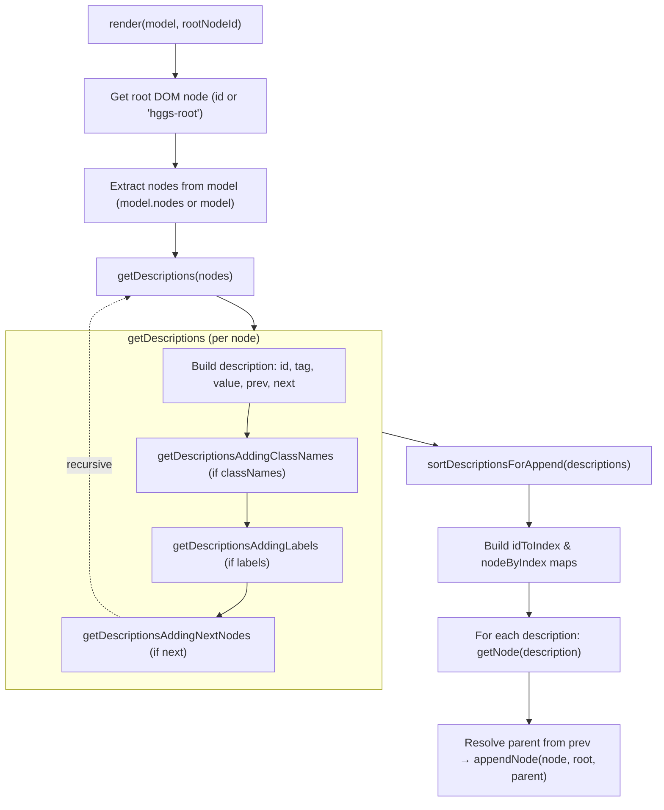

# Higgsboson Utils

## Description

This package contains utility functions for the Higgsboson project.

## Render

Render utility to render **an opinionated higgsboson component model** into DOM nodes.

### Flow description



### Markup headers

`addMarkupHeaders(model, rootNodeId = "hggs-root")` is called by every migrated component page right after `render(model)`, and decorates the rendered examples with page headings:

```html
<h1 class="hggs-h1">Box</h1>
<h2 class="hggs-h2">Box primary rounded</h2>
<div class="hggs-box hggs-box--primary hggs-box--rounded">…</div>
<!-- … one h2 per example … -->
```

- **`h1` page title** comes from `model.title` and appears once, on top of the root node.
- **`h2` case heading** describes the example that follows, so every section says what it shows:
  - if the model declares a `cases: string[]` array with exactly one entry per rendered example, the entry is used verbatim (explicit wins — this is how `box`, `checkbox` and `list` distinguish structurally different cases, e.g. `"Checkbox group"` or `"Box with header and body primary rounded"`);
  - otherwise the label is derived as `model.title` plus the `--modifiers` on the example's root element (e.g. `Avatar` → `Avatar big`, `Box` → `Box rounded`). Only the root element is inspected, so modifiers belonging to child components (a dialog with `hggs-button--primary` inside) never leak into the heading.
  - when `cases.length` does not match the example count, the model falls back to derived labels and warns (with `LOGS_WARNINGS_ACTIVE=true`).
- Every element the module adds carries the `hggs-markup-header` marker class; a repeated call rebuilds them instead of duplicating them.
- Markup headers are page decoration only: they are **not** part of `render()` output, so mocks and golden tests keep covering the pure node builder. The exception is the optional `cases` array on a model — it is data for the headings, ignored by `render()`, and `mocks.test.mjs` locks its length to the number of rendered examples.

### Mock golden files

Every migrated component in `packages/core/src/components/<name>/` ships a `<name>-mock.html` file: the expected DOM that `render(model)` must produce for its `<name>-model.mjs`.

- The **render output is the source of truth**: regenerate the mocks from the models with:

  ```bash
  npm run mocks:update:utils            # every migrated component
  npm run mocks:update --workspace packages/utils box list   # only some
  ```

- `mocks.test.mjs` renders every model and diffs it against its mock (tag, attributes, text and child order — whitespace-insensitive so prettier formatting does not matter). If a model or the renderer changes without regenerating the mock, the test fails with the exact differences.
- The same test enforces the component file set: `<name>.html`, `<name>.css`, `<name>.md`, `<name>-model.mjs` and `<name>-mock.html`.
